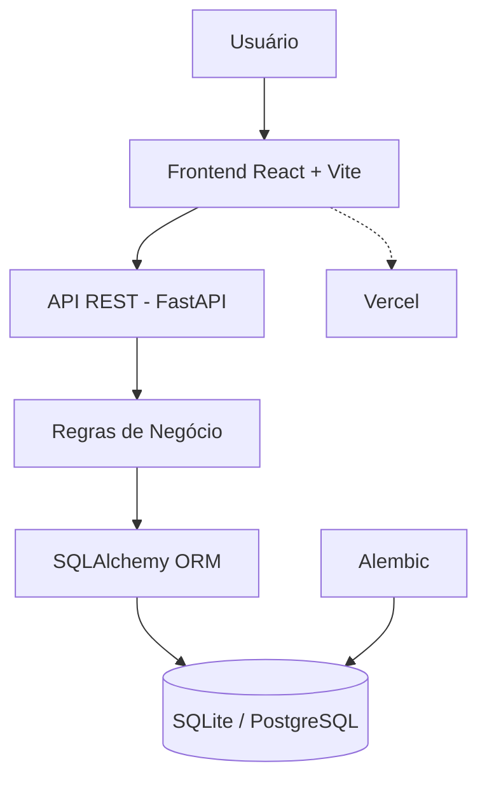
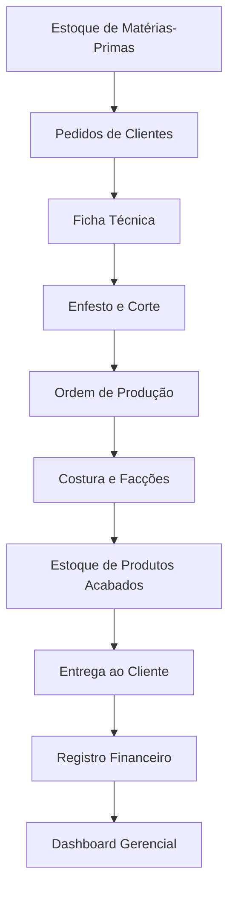

# 🧵 Confecção Alfa — Sistema de Gestão Industrial e Comercial

**Sistema integrado para gestão de processos industriais, comerciais, estoque, produção e finanças de confecções têxteis.**


---

## 📌 Sobre o Projeto

O **Confecção Alfa** é um sistema de gestão industrial e comercial desenvolvido para atender às necessidades operacionais de pequenas e médias confecções têxteis.

A aplicação centraliza os principais processos de uma indústria de confecção, integrando controle de estoque, pedidos comerciais, engenharia de produto, planejamento e controle da produção (PCP), corte, rendimento têxtil, costura, facções e gestão financeira.

O sistema foi desenvolvido para trabalhar com diferentes segmentos produtivos, incluindo:

- **Camisetas e artigos de malharia:** controle de tecidos, rendimento por quilograma, enfesto, corte, costura e produtos acabados.
- **Moda Íntima:** controle de materiais, aviamentos, fichas técnicas, produção, costura e terceirização.

O objetivo é substituir controles manuais e planilhas dispersas por um ambiente centralizado, proporcionando maior rastreabilidade das operações, controle dos recursos produtivos e informações gerenciais para tomada de decisão.

## 🎯 Objetivos do Sistema

- Centralizar as informações industriais e comerciais.
- Controlar entradas, saídas e movimentações de estoque.
- Gerenciar pedidos de clientes e prazos de entrega.
- Digitalizar fichas técnicas e especificações dos produtos.
- Monitorar o consumo e o rendimento de matérias-primas.
- Acompanhar ordens de produção e etapas de fabricação.
- Controlar serviços realizados por oficinas e facções terceirizadas.
- Gerenciar o estoque de produtos acabados.
- Integrar compras, vendas e despesas ao controle financeiro.
- Disponibilizar indicadores de desempenho industrial e financeiro.

---

## 🛠️ Tecnologias Utilizadas

O projeto utiliza uma arquitetura dividida entre frontend e backend, com comunicação por meio de APIs REST.

| Camada | Tecnologia | Finalidade |
|---|---|---|
| Frontend | React | Construção da interface |
| Build Tool | Vite | Desenvolvimento e compilação |
| Linguagem Frontend | JavaScript | Lógica da aplicação |
| Estilização | Vanilla CSS | Identidade visual e responsividade |
| Backend | Python | Regras de negócio |
| Framework | FastAPI | Desenvolvimento das APIs REST |
| ORM | SQLAlchemy | Mapeamento objeto-relacional |
| Banco de dados | SQLite / PostgreSQL | Persistência dos dados |
| Migrações | Alembic | Versionamento do esquema do banco |
| Versionamento | Git / GitHub | Controle de código-fonte |
| Deploy Frontend | Vercel | Hospedagem da aplicação |

### Arquitetura da Aplicação



---

## 🏭 Fluxo Operacional

O sistema acompanha o ciclo operacional da confecção, desde a aquisição das matérias-primas até a entrega dos produtos e apuração financeira.



## 📦 Módulos e Funcionalidades

### 1. Dashboard Gerencial

Painel de indicadores para acompanhamento da operação industrial e comercial.

**Principais funcionalidades:**

- Total de peças produzidas.
- Quantidade de produtos disponíveis no estoque.
- Total de peças entregues.
- Alertas de estoque mínimo.
- Indicadores de rendimento têxtil.
- Comparativo entre custos de matérias-primas e faturamento.
- Acompanhamento da evolução financeira mensal.
- Indicadores consolidados da produção.

### 2. Controle de Estoque

Gerenciamento de matérias-primas, tecidos e aviamentos utilizados na fabricação.

**Funcionalidades:**

- Cadastro de insumos.
- Separação entre tecidos e aviamentos.
- Controle de estoque em quilogramas, metros e unidades.
- Registro de entradas de materiais.
- Registro de fornecedores e notas fiscais.
- Cálculo do custo médio dos insumos.
- Monitoramento de estoque mínimo.
- Indicadores de estoque normal, atenção e crítico.
- Controle do valor patrimonial das matérias-primas.

### 3. Pedidos Comerciais

Gerenciamento dos pedidos realizados por clientes e lojistas.

**Funcionalidades:**

- Cadastro de pedidos.
- Distribuição de quantidades por tamanho (P, M, G e GG).
- Cálculo automático do total de peças.
- Registro do valor financeiro do pedido.
- Definição de prazos de entrega.
- Geração automática de códigos sequenciais.
- Acompanhamento do ciclo de vida do pedido.
- Confirmação de entrega e baixa no estoque de produtos acabados.

**Fluxo de status:**

`Aguardando Produção → Em Produção → Pronto no Estoque → Entregue`

### 4. Ficha Técnica Digital

Módulo de engenharia de produto responsável pelo cadastro das especificações de fabricação.

**Funcionalidades:**

- Cadastro de modelos de produtos.
- Definição de grade de tamanhos.
- Especificação do consumo de tecido por peça.
- Cálculo do rendimento esperado da malha.
- Vinculação de matérias-primas e aviamentos.
- Cálculo do custo de insumos por unidade produzida.
- Controle de consumo fracionado de materiais.

**Exemplo de cálculo de consumo:**

| Insumo | Consumo por peça |
|---|---:|
| Meia Malha | 0,180 kg |
| Etiqueta | 1 unidade |
| Tag | 1 unidade |
| Linha 120 | 0,020 carretel |

O sistema considera o consumo individual dos insumos para estimar o custo de fabricação de cada produto.

### 5. Enfesto, Corte e Rendimento Têxtil

Módulo responsável pelo acompanhamento do aproveitamento da matéria-prima durante o processo de corte.

**Funcionalidades:**

- Registro do peso real dos rolos utilizados.
- Cálculo de quantidade planejada de peças.
- Registro da quantidade efetivamente cortada.
- Cálculo do rendimento real da malha.
- Comparação entre rendimento esperado e realizado.
- Identificação de perdas e desperdícios.
- Geração automática de Ordem de Produção (OP).

**Exemplo de cálculo:**

- Peso utilizado: 45 kg.
- Quantidade cortada: 252 camisetas.
- Rendimento real: 5,60 peças/kg.

Fórmula:

`Rendimento = Quantidade de peças cortadas ÷ Peso da malha`

### 6. Costura e Facções

Gerenciamento das etapas de costura internas e terceirizadas.

**Funcionalidades:**

- Controle de envio de pacotes para oficinas.
- Registro das quantidades enviadas.
- Controle de aviamentos e margens de segurança.
- Aplicação de margem padrão de 3% para aviamentos.
- Registro do retorno das peças costuradas.
- Auditoria de perdas na costura.
- Controle de produção por facção.
- Entrada de produtos conferidos no estoque de acabados.

### 7. Registro Financeiro

Módulo de acompanhamento dos custos, receitas e resultados financeiros da confecção.

**Funcionalidades:**

- Registro de despesas operacionais.
- Integração com compras de matérias-primas.
- Integração com pedidos comerciais.
- Consolidação mensal de receitas e despesas.
- Apuração do lucro líquido.
- Sincronização dos dados de estoque e vendas.
- Identificação de movimentações reais e projeções.
- Exportação de relatórios financeiros em PDF.
- Histórico mensal de resultados.

**Fórmula de apuração:**

`Lucro = Faturamento - Compras de Matéria-Prima - Outros Custos`

---

## 👕 Segmentos Produtivos

A aplicação possui uma estrutura preparada para trabalhar com diferentes segmentos de confecção.

### Segmento: Camisetas e Malharia

Módulo especializado no gerenciamento de produtos de malharia.

Principais recursos:

- Dashboard de camisetas.
- Estoque de malhas e aviamentos.
- Pedidos comerciais.
- Fichas técnicas.
- Enfesto e corte de malha.
- Controle de rendimento em peças/kg.
- Costura e facções.
- Estoque de camisetas acabadas.
- Registro financeiro.

### Segmento: Moda Íntima

Módulo voltado ao gerenciamento de produtos de moda íntima.

Principais recursos:

- Gestão de matérias-primas e aviamentos.
- Fichas técnicas de produtos.
- Controle de consumo por peça.
- Gestão comercial.
- Controle de corte e rendimento.
- Costura e terceirização.
- Gestão de equipe.
- Controle de estoque de produtos acabados.

---

## 🎨 Identidade Visual e Experiência do Usuário

O projeto utiliza uma identidade visual inspirada no conceito **Ateliê Artesanal**, combinando elementos de elegância editorial com a praticidade necessária para ambientes industriais.

**Características visuais:**

- Tipografia editorial: Lora e Playfair Display.
- Tipografia de interface: Plus Jakarta Sans e DM Sans.
- Paleta de cores orgânicas.
- Fundos em tons off-white e creme.
- Textos em tons de carvão e marrom profundo.
- Botões em azul alfaiataria e verde sálvia.
- Indicadores de status inspirados em etiquetas de tecido.
- Tabelas com foco em legibilidade e organização.
- Formulários padronizados e componentes reutilizáveis.

A interface busca proporcionar uma experiência intuitiva, organizada e agradável para usuários administrativos e operadores da produção.

---

## 📁 Estrutura do Projeto

A organização principal do repositório está dividida entre backend e frontend.

```text
CONFECÇÃO-ALFA/
│
├── backend/
│   ├── alembic/
│   │   └── versions/
│   ├── app/
│   │   ├── core/
│   │   ├── models/
│   │   ├── routers/
│   │   ├── schemas/
│   │   ├── services/
│   │   ├── database.py
│   │   └── main.py
│   ├── alembic.ini
│   └── requirements.txt
│
├── frontend-alfa/
│   ├── public/
│   ├── src/
│   │   ├── components/
│   │   ├── context/
│   │   ├── pages/
│   │   ├── services/
│   │   ├── App.jsx
│   │   ├── App.css
│   │   └── main.jsx
│   ├── index.html
│   ├── package.json
│   └── vercel.json
│
├── .gitignore
├── vercel.json
└── README.md
```

*Observação: a estrutura apresenta a organização principal e pode variar conforme a evolução do projeto.*

---

## ⚙️ Instalação e Execução Local

### Pré-requisitos

Antes de executar o projeto, instale:

- Python 3.12 ou compatível.
- Node.js e npm.
- Git.
- SQLite ou PostgreSQL, conforme a configuração utilizada.

### 1. Clonar o repositório

```bash
git clone URL_DO_REPOSITORIO
```

Entre na pasta:

```bash
cd NOME_DO_REPOSITORIO
```

### 2. Configurar o Backend

Entre na pasta:

```bash
cd backend
```

Crie o ambiente virtual:

```bash
python -m venv .venv
```

Ative o ambiente virtual no Windows:

```powershell
.venv\Scripts\Activate.ps1
```

Instale as dependências:

```bash
pip install -r requirements.txt
```

Configure as variáveis de ambiente e a conexão com o banco de dados conforme a configuração do projeto.

Execute as migrações, quando aplicável:

```bash
alembic upgrade head
```

Inicie o servidor:

```bash
python -m uvicorn app.main:app --reload
```

O backend ficará disponível em:

`http://127.0.0.1:8000`

Documentação interativa da API:

- Swagger UI: http://127.0.0.1:8000/docs
- ReDoc: http://127.0.0.1:8000/redoc

### 3. Configurar o Frontend

Abra outro terminal e entre na pasta:

```bash
cd frontend-alfa
```

Instale as dependências:

```bash
npm install
```

Inicie o ambiente de desenvolvimento:

```bash
npm run dev
```

O Vite exibirá no terminal o endereço local para acessar a aplicação.

---

## 🔄 Integrações e Regras de Negócio

Um dos principais diferenciais do Confecção Alfa é a integração entre os módulos.

| Operação | Integração |
|---|---|
| Entrada de compras | Atualiza o estoque e alimenta os dados financeiros |
| Cadastro de pedido | Registra a demanda comercial |
| Ficha técnica | Define o consumo e os custos dos insumos |
| Finalização do corte | Gera uma Ordem de Produção |
| Retorno da costura | Atualiza o estoque de produtos acabados |
| Entrega do pedido | Realiza a baixa dos produtos acabados |
| Sincronização financeira | Consolida compras, vendas e despesas |
| Atualização dos indicadores | Alimenta o dashboard gerencial |

---

## 🚀 Melhorias e Evoluções

O projeto possui evolução contínua, com foco em automação dos processos e aprimoramento da experiência dos usuários.

Entre as melhorias implementadas estão:

- Geração automática de códigos para pedidos e ordens de produção.
- Geração automática de referências para insumos.
- Integração entre estoque, comercial e financeiro.
- Controle de rendimento real de malha.
- Cálculo de consumo fracionado de aviamentos.
- Migrações de banco de dados com Alembic.
- Padronização dos componentes de navegação.
- Alternância entre segmentos produtivos.
- Melhorias na apresentação de tabelas e formulários.
- Exportação de relatórios financeiros em PDF.
- Aprimoramento dos indicadores gerenciais.

---

## 🔮 Próximas Evoluções

Possíveis frentes de evolução do sistema:

- Ampliação da rastreabilidade das ordens de produção.
- Relatórios gerenciais mais detalhados.
- Histórico de movimentações por insumo e produto.
- Controle avançado de produtividade por oficina.
- Aprimoramento da auditoria de perdas.
- Testes automatizados de API e regras de negócio.
- Ampliação dos recursos de segurança e controle de acesso.
- Evolução da infraestrutura de implantação e monitoramento.

---

## 👨‍💻 Desenvolvimento

O Confecção Alfa é um projeto de desenvolvimento de software voltado à aplicação de tecnologia na gestão industrial e comercial do setor de confecção têxtil.

O desenvolvimento envolve modelagem de dados, arquitetura backend, APIs REST, interfaces web, integração entre módulos e implementação de regras de negócio específicas do ambiente produtivo.

**Principais áreas técnicas:**

- Desenvolvimento Backend com Python e FastAPI.
- Desenvolvimento Frontend com React.
- Modelagem e gerenciamento de banco de dados.
- Integração entre sistemas por APIs REST.
- Engenharia de software e organização de código.
- Automação de processos industriais e comerciais.

---

## 📄 Licença

Este projeto ainda não possui uma licença de distribuição definida. Seu uso, reprodução e distribuição devem ser autorizados pelo responsável pelo repositório.

---

<p align="center">
  <strong>Confecção Alfa</strong><br>
  Gestão inteligente para a indústria de confecção têxtil.
</p>